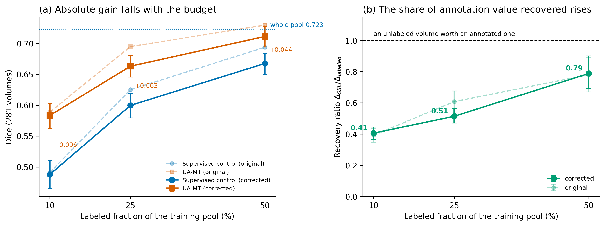
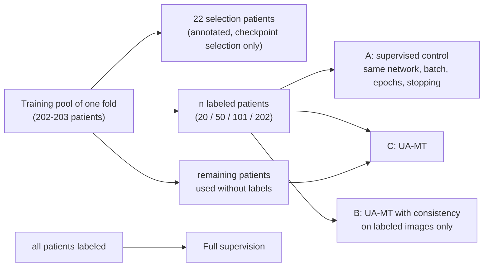
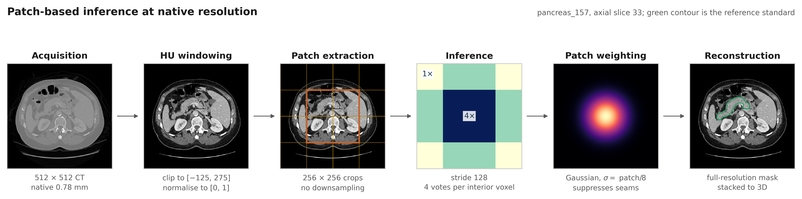
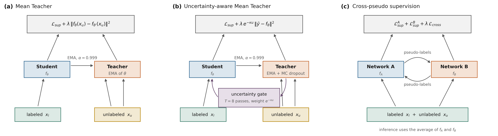
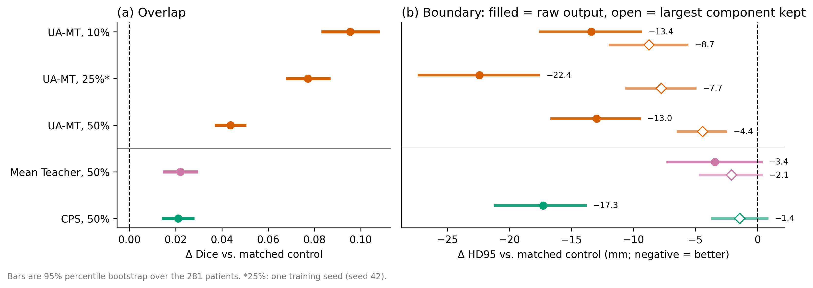
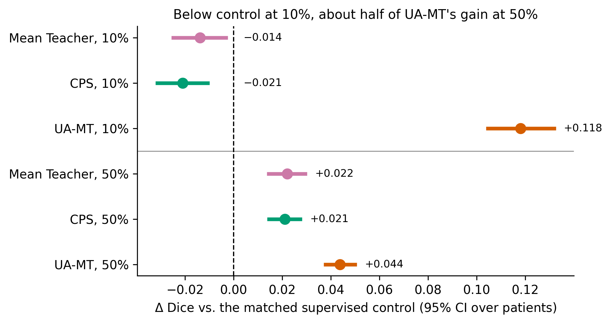
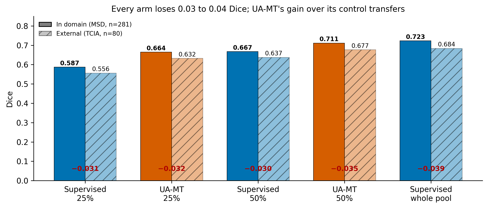

# How much annotation value does semi-supervised learning recover?

**A matched-control measurement of uncertainty-aware Mean Teacher (UA-MT) across label budgets, for pancreas segmentation in CT.**

   

This repository holds the code, the exact patient-level splits and the per-patient scores behind the paper *How Much Annotation Value Does Uncertainty-Aware Semi-Supervised Learning Recover? A Matched-Control Measurement Across Label Budgets in Pancreas CT* (Istiaque Ahmed and Kursat Komurcu, Vilnius University; under review). Every corrected-protocol number, table and figure in the paper can be regenerated from the files here **without a GPU**.

---

## In one picture



**(a)** Against a supervised control trained on exactly the same labeled patients, UA-MT adds the most Dice when labels are scarcest. **(b)** But the *share* of the value of annotating those scans that it recovers is lowest exactly there, and rises with the budget. Solid lines: corrected protocol (primary). Faded lines: our original protocol (sensitivity analysis).

## Key findings

| | Finding |
|---|---|
| 1 | The absolute gain of UA-MT **falls** with the label budget (+0.096, +0.063, +0.044 Dice at 10, 25, 50% labels) while the recovered share of annotation value **rises** (0.41, 0.51, 0.79). |
| 2 | At 25% labels, UA-MT is **indistinguishable from supervision on twice the labels** (difference -0.0045 Dice, 95% CI [-0.011, +0.002]). Counting the 22 annotated selection patients every arm needs, UA-MT matches about **1.6 to 1.7 times the total annotations** at every budget. At 10% it falls short of 25% supervision. |
| 3 | About **half** of the gain needs distinct unannotated patients. The other half also appears when the consistency term sees only labeled images, and may come from extra optimizer steps rather than from consistency (open, see Limitations). |
| 4 | **Augmentation does not absorb the gain**: at 10% the SSL gain is +0.096 without and +0.099 with augmentation (interaction p = 0.62). |
| 5 | UA-MT improves HD95 at every budget, but **method rankings by boundary distance depend on post-processing**: on raw output CPS leads, after keeping the largest connected component only UA-MT still improves. |
| 6 | On 80 external NIH Pancreas-CT volumes the gain transfers, with **no robustness advantage** (difference-in-differences excludes an advantage above 0.013 Dice). |

The contribution is the **measurement protocol**, not a new segmentation model: the patch-based 2D U-Net reaches 0.723 Dice with full supervision, against 0.851 for nnU-Net `3d_fullres` on the same folds.

---

## The question

A group has acquired a pool of CT scans and can annotate only some of them. How much of the value of annotating the rest does semi-supervised training already deliver if the rest are left unlabeled?

This is a **finite-pool** question: it compares using *all* remaining scans unlabeled with annotating *all* of them. It is not the value of the next single scan, and semi-supervised training and further annotation can of course be combined.

## Study design



| Contrast | What it measures |
|---|---|
| **C - A** (`Delta_SSL`) | What the complete semi-supervised procedure adds over a control matched on labels, network and recipe |
| **FULL - A** (`Delta_labeled`) | What annotating the same remaining scans would add instead |
| **(C - A) / (FULL - A)** | The **recovery ratio**: share of annotation value recovered without annotating |
| **B - A** and **C - B** | Split of the gain into "consistency on images already seen" and "distinct unannotated patients" |

Every comparison is paired per patient over all 281 MSD volumes (five-fold cross-validation, one out-of-fold prediction per volume), with patient-bootstrap confidence intervals.

### Corrected vs original protocol

| | Original protocol (sensitivity only) | Corrected protocol (primary) |
|---|---|---|
| Checkpoint selection | on the fold that is then scored | on 22 inner-validation patients |
| Unlabeled patches | centred on the annotated pancreas (labels leak into the "unlabeled" stream) | drawn from a body mask; label files are never opened |
| Effect | absolute Dice up to 0.032 higher | |
| SSL gain | not measurably inflated, same curve shape | |

## Pipeline and methods



Native-resolution 256 x 256 patches, HU window [-125, 275], sliding-window inference with Gaussian patch weighting.



UA-MT here is a **soft Monte Carlo variance variant** of Yu et al. (2019): eight stochastic teacher passes, consistency weighted by exp(-10 u) rather than a hard entropy mask. Mean Teacher and cross-pseudo supervision are secondary comparisons.

---

## Results

### Annotation-recovery curve (corrected protocol, 281 volumes)

| Labels per fold | Supervised control | UA-MT | Gain (95% CI) | Recovery ratio (95% CI) |
|---|---|---|---|---|
| 10% (20) | 0.488 | 0.583 | +0.096 [+0.084, +0.108] | 0.41 [0.37, 0.45] |
| 25% (50), 3 seeds | 0.600 | 0.663 | +0.063 [+0.057, +0.070] | 0.51 [0.47, 0.56] |
| 50% (101) | 0.667 | 0.711 | +0.044 [+0.038, +0.050] | 0.79 [0.69, 0.90] |
| 100% (202) | 0.723 | | | 1 |

Ratio at 50% minus ratio at 10%: **+0.38 [+0.28, +0.50]**.

### What UA-MT is worth in labels

| Training labels | Unlabeled scans | UA-MT matches supervision on | Multiple | Total annotations incl. 22 selection | Multiple |
|---|---|---|---|---|---|
| 20 | 182 | 46 [43, 48] | x2.28 | 42 -> 68 | x1.61 |
| 50 | 152 | 98 [93, 104] | x1.95 | 72 -> 120 | x1.66 |
| 101 | 101 | 181 [171, 192] | x1.79 | 123 -> 203 | x1.65 |

Piecewise-linear inversion of the measured supervised curve, recomputed in each of 10,000 patient resamples.

### Boundary metrics depend on post-processing



Filled: raw network output. Open: largest 3D connected component kept in every arm, control included. CPS has the largest raw HD95 gain with half of UA-MT's Dice gain; after filtering only UA-MT's improvement has an interval excluding zero.

### Other SSL methods (secondary)



With one shared, untuned recipe and one seed, Mean Teacher and CPS fall below their control at 10% and gain about half as much as UA-MT at 50%. This compares our implementations, not the methods in general.

### External cohort



NIH Pancreas-CT (80 of 82 scans; cases 25 and 70 are duplicates) differs in site, scanner, pathology and label definition. Every arm loses 0.03 to 0.04 Dice; UA-MT's gain over its control is kept (+0.076 at 25%, +0.039 at 50%).

---

## Limitations, stated plainly

* **Optimizer steps.** The semi-supervised arms take two optimizer steps per control step within an epoch and sample batches with replacement. Part of the gain, and especially the "consistency on labeled images" half of the decomposition, may come from this. A step- and sampler-matched control is the next experiment.
* **Patch sampler in the decomposition.** Arm C's consistency patches come from a body mask; arm B reuses the labeled stream, half of which is centred on the pancreas.
* **Uncertainty.** Intervals cover patient sampling only, conditional on one split per fold; training seeds were repeated only at 25%. No formal equivalence test.
* **Stopping rule at 10%.** The primary 10% control starts early stopping at epoch 30; stopping from epoch 1 lowers it by 0.022 Dice and would raise the 10% gain to +0.118.
* **Scope.** One organ, one source dataset, one UA-MT variant, a backbone well below nnU-Net.

---

## Repository layout

| Path | Contents |
|---|---|
| `baseline/code/` | Preprocessing, training, inference, scoring and analysis scripts |
| `baseline/models/<run>/fold_<k>/` | `split_info.json` (exact patient IDs of labeled, unlabeled, selection and scored sets), `dice_results_gaussian.json` (per-patient Dice), `best_info.json` (selected epoch), `log.csv` (training curve). No weights. |
| `baseline/logs/hd95_5fold*/` | Per-patient HD95, ASD and Dice, raw and after largest-component filtering |
| `baseline/logs/tcia_crossdomain/` | Per-patient external Dice, one line per volume and fold model |
| `baseline/logs/*.md, *.json` | Pooled results as reported in the paper |
| `docs/figures/` | Figures used in this README |

### Runs

| Run name | Arm |
|---|---|
| `clean_sup_{10,25,50,100}` | Supervised control. `clean_sup_10_es30` is the primary 10% control (early stopping from epoch 30); `clean_sup_10` stops from epoch 1 and is the rule-matched control for Mean Teacher, CPS and arm B at 10% |
| `clean_uamt_{10,25,50}` | UA-MT |
| `clean_*_25_ts{1,2}` | Training-seed repeats at 25% (seed 42 is the unsuffixed run) |
| `clean_mt_{10,50}`, `clean_cps_{10,50}` | Mean Teacher, cross-pseudo supervision |
| `clean_armb_{10,50}` | Arm B: consistency on labeled images only |
| `aug_sup_10`, `aug_uamt_10`, `augab_*` | Augmentation x SSL design at 10% |

## Data

* **MSD Task07 Pancreas**, 281 training volumes: http://medicaldecathlon.com/ -> `data/Task07_Pancreas/`. Pancreas and tumour labels are merged into one foreground class.
* **NIH Pancreas-CT** (TCIA): https://doi.org/10.7937/K9/TCIA.2016.tNB1kqBU -> NIfTI in `data/tcia/imagesTs` and `data/tcia/labelsTs`.

## Reproduce the paper's numbers (no GPU)

```bash
pip install -r requirements.txt
python baseline/code/collect_oct15.py            # matched contrasts, seeds, MT/CPS, arm B
python baseline/code/recompute_10pct_es30.py     # 10% numbers with the primary control
python baseline/code/label_equivalent_corrected.py
python baseline/code/collect_oct16_eval.py       # HD95/ASD/LCC and external contrasts
python baseline/code/collect_aug_2x2.py          # augmentation x SSL
python baseline/code/make_tables_corrected.py    # LaTeX tables
python baseline/code/make_figs_corrected.py      # figures
```

Run from the repository root.

## Retrain

```bash
# patch sets
python baseline/code/preprocess_v5_patches.py --raw_dir data/Task07_Pancreas --output_dir data/preprocessed_v5_patches   # labeled stream, 70 patches per patient
python baseline/code/preprocess_v7_labelfree.py --raw_dir data/Task07_Pancreas --output_dir data/preprocessed_v7_labelfree

# one fold of the primary 10% control and of UA-MT (folds 0-4)
python baseline/code/run_supervised_fraction.py --data_dir data/preprocessed_v5_patches --raw_dir data/Task07_Pancreas \
  --fold 0 --frac 10 --inner_val 22 --blend gaussian --epochs 150 --es_start 30 --output_dir baseline/models/clean_sup_10_es30
python baseline/code/run_ssl_uamt_5fold.py --data_dir data/preprocessed_v5_patches --raw_dir data/Task07_Pancreas \
  --unlabeled_data_dir data/preprocessed_v7_labelfree --fold 0 --frac 10 --inner_val 22 --blend gaussian --epochs 150 \
  --output_dir baseline/models/clean_uamt_10
```

Useful options: `--consistency_source labeled` (arm B), `--train_seed`, `--aug`. One run takes under three GPU-hours on a V100 (32 GB). Python 3.10.12, TensorFlow 2.13 (see `requirements.txt`).

## Citation

The paper is under review; until it is published please cite this repository:

```bibtex
@misc{ahmed2026annotationrecovery,
  title  = {How Much Annotation Value Does Uncertainty-Aware Semi-Supervised Learning Recover?
            A Matched-Control Measurement Across Label Budgets in Pancreas CT},
  author = {Ahmed, Istiaque and Komurcu, Kursat},
  year   = {2026},
  note   = {Code and data: https://github.com/Utshox/-SSL-annotation-recovery}
}
```

## License and contact

Code: MIT (see `LICENSE`). The datasets keep their own licenses. Trained weights are available from the corresponding author on request: Istiaque Ahmed, Institute of Computer Science, Vilnius University (istiaque.ahmed@mif.stud.vu.lt).
